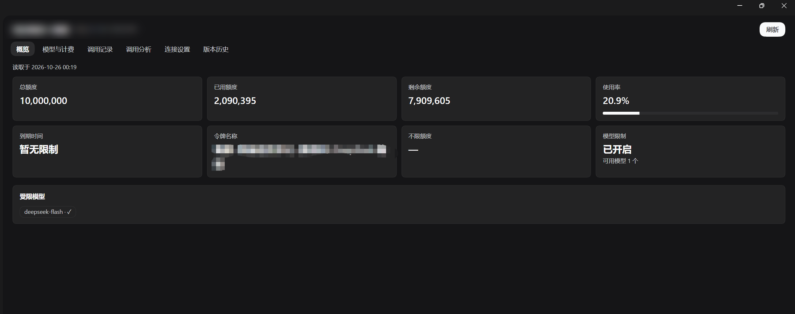
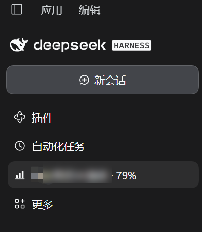
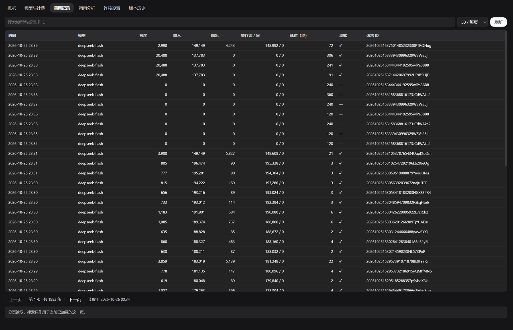

# dsh-ai-quota

[English](README.en.md) | **中文**

AI 额度面板 —— 一个 **DeepSeek Harness（DSH）** 的 Cordis 插件。

---

## ⚡ 一键安装：把下面整段复制给你的 DSH

> **不用 clone、不用手填命令。** 这段提示词已经写好安装命令、镜像回退、版本陷阱和验证步骤；
> 对方的 DSH 读完会自己装完并回报。**只发一个链接让它猜，大概率会装错版本或卡在 404。**

```text
你是 DSH，请帮我安装一个插件并验证它真的可用，不要只给我操作步骤。

插件：AI 额度面板（npm 包名 dsh-ai-quota，仓库 https://github.com/hustwxw/dsh-ai-quota）

必须照这个顺序做：
1) 调用 plugin_manager，action = install_bundle，target = dsh-ai-quota；
   装完确认它 enabled = true。
2) 如果返回 ERR_PNPM_FETCH_404 / not-found / 包不存在：
   - 先用 registry = https://registry.npmjs.org 重试一次（国内镜像对新包有几分钟同步延迟）；
   - 仍然失败就 git clone https://github.com/hustwxw/dsh-ai-quota 到本地，
     再把 target 换成该目录的绝对路径重装。
   - 绝对不要安装 0.0.0-stage——那是 npm 自动生成的空壳占位包，装了侧边栏什么都不会出现。
     应该装 latest（当前 0.6.0）。
3) 装完提示我刷新 Web UI，并确认侧边栏出现「AI 额度」图标（位置在「插件 / 自动化任务」之后）。
   你可以用 cordis_inspect_query（platform = client，provider = Slots，method = listSubTree，
   root = main）确认里面有没有 key = ai-quota-panel 的条目。
4) 向我汇报三件事：实际装上的版本号、侧边栏图标是否出现、我接下来需要填什么。

红线：不要读取、不要向我索要、也不要替我填写 skey 或网关地址——
那些我自己在面板的「连接设置」里填。skey 只应该存在我的本机凭据库里。
```

装完对方要做的事只有一件：**面板 → 连接设置 → 填网关地址和 skey**（默认地址是占位值，不填只会显示「未配置」）。

| 常见失败 | 处理 |
| --- | --- |
| `ERR_PNPM_FETCH_404` / 找不到包 | 加 `registry = https://registry.npmjs.org` 重试；或改走 clone + 目录安装 |
| 装上了但侧边栏没图标 | 刷新 Web UI；仍未出现就确认 bundle 是 enabled 状态 |
| 装成了 `0.0.0-stage` | 那是空壳占位包，卸载后改装 `latest` |
| 图标在但数字不显示 | 没配 skey 或网关不可达——属于预期行为，不会显示过期数字 |

---

把公司 AI 额度网关（基于 [New API](https://github.com/Calcium-Ion/new-api)）做成 Harness Web UI 里的常驻面板：侧边栏那一行直接显示剩余额度百分比，点图标即刷新；点进去可以看额度概览、模型限制、分页调用记录、模型计费、按时间范围做的调用分析与钻取，以及按官方价目估算的**用量价值**（已用多少钱、全部配额值多少钱、还剩多少钱）。

- 界面在浏览器里（React + 主题变量，**不依赖任何 Harness 客户端包**），数据由 Harness 的 Host 进程直连内网网关。
- skey 只存进本机凭据库（Harness `credentials`），**不写浏览器存储、不回传页面**——页面只知道「已配置 / 未配置」。
- 只读：全程只发 GET，不修改网关任何数据。
- 侧边栏与面板标题的**显示名称可自定义**（默认「AI 额度」），见[显示名称](#显示名称)。
- 与同目录源码的桌面版 `ai-quota-tauri`（Tauri 2 + Rust + React，v0.3.0）功能对齐，但不用再单独开一个客户端。



侧边栏那一行把剩余额度直接挂在名字后面 —— 点图标即刷新，点文字进面板（截图里的名字是配置出来的，已做脱敏）：



调用记录：服务端分页（20 / 50 / 100 每页）、行内搜索模型名与请求 ID、点行看全部字段：



## 显示名称

侧边栏那一行和面板标题都用同一个可配置名称，默认是「AI 额度」：

1. 打开面板 → **连接设置** → 「显示名称」。
2. 输入你的名字（最多 40 字符，例如 `AI 额度`、`团队额度`、`研发配额`），**移出输入框或按回车**立即生效——侧边栏那一行和面板标题同时改。
3. 清空即恢复默认「AI 额度」。

实现上它是**纯浏览器偏好**：

- 存在 `localStorage` 的 `dsh-ai-quota/display-name`，不进凭据库、不上传、不影响别人；
- 换浏览器或清缓存后回到默认值；
- 只改名字，不改路由、不改数据，百分比照旧跟在名字后面（`我的额度 · 79%`）。

## 侧边栏额度百分比

侧边栏那一行显示成 `<显示名称> · 79%`：

| 行为 | 说明 |
| --- | --- |
| 数字含义 | `剩余额度 ÷ 总额度`，四舍五入到整数；无限额度显示 `∞` |
| 自动更新 | 每 15 分钟一次（页面打开期间；关掉标签页即停） |
| 手动更新 | **点那一行的柱状图图标**（不会打开面板，图标转圈 → 绿/红）；点文字才是进面板。面板右上角「刷新」等价 |
| 回到标签页 | 自动更新一次（30 秒节流，避免来回切窗口把网关打满） |
| 查不到就不显示 | 没 skey、网关不通、业务失败、返回里没额度字段 —— 只留名字，绝不留一个过期数字 |
| 清凭据 | 保存/清除 skey 时立刻抹掉数字 |

## 功能

| 标签页 | 内容 |
| --- | --- |
| **用量价值** | 默认打开的第一个标签页：已用价值、全部配额估算、剩余配额估算、配额对账**置顶**，下面是分项估算与模型明细，采集与价目设置沉在底部 |
| 连接设置 | 服务器地址、skey 保存 / 从环境变量 `AI_QUOTA_SKEY` 导入 / 清除凭据 |
| 概览 | 总额度、已用、剩余、占比、到期时间（`expires_at <= 0` 显示「暂无限制」）、令牌名、模型限制开关与逐模型上限 |
| 模型与计费 | `/v1/models` 的模型清单与端点类型；`/api/pricing` 的价格表与分组倍率 |
| 调用记录 | 服务端分页（20 / 50 / 100），行内搜索模型名与 request_id，点行看完整字段 |
| 调用分析 | 时间范围 + 时区（UTC / UTC+8）+ 天/小时粒度；Host 分页采集后本地聚合出额度趋势、token 趋势、模型排行、24 小时分布；点柱子钻取明细（50 条/页） |
| 版本历史 | 每个版本改了什么 |

调用分析是「采集 + 本地聚合」：Host 从第 1 页顺着翻，直到拿到不满 50 条的页为止（网关唯一的结束信号），按 `id` 去重并统计范围外/重复/冲突条数，再按粒度和时区聚合。保护上限 20000 页 / 200000 条 / 30 分钟，触顶时状态行会说明结果可能不完整。

## 用量价值

这一页按 DeepSeek 官方价目与官方时段规则自行估算，面板自动采集、自动重算，不用每次手跑脚本。

| 环节 | 规则 |
| --- | --- |
| 采集范围 | 默认「全部时间」翻完所有页；取消勾选可按日期范围采集（UTC+8、最长 366 天）。网关分页是新到旧，翻到整页都比范围更早即**提前结束**（两天范围实测 24 页收工，全量 92 页）；触到本机上限才算「不完整」 |
| 只算消费 | 日志 `type = 2` 才计价；`type = 4 / 5`（失败请求）与其他记录分开统计，不重复计费 |
| 三段 token | 命中 = `cache_tokens`（缺失时用 `cached_tokens`，都没有按 0）；未命中 = `输入 − 命中`（命中大于输入直接报错停止）；输出 = `completion_tokens`。`cache_write_tokens` 不叠加进输入 |
| 高峰判定 | 工作日且 UTC 01:00–04:00、06:00–10:00 → 高峰价；其余时段、周末、你列出的法定节假日 → 优惠价 |
| 计价 | `(命中×命中价 + 未命中×未命中价 + 输出×输出价) ÷ 1,000,000`，每个模型用自己的价目，查不到价格的模型单独列出、绝不套用别的模型价 |
| 模板价 | 未知型号可点「按模板补价」起草（借 Flash / V4-Pro 的价目），但那一行会挂「模板价，待核对」标签，改一个数字即摘掉——借用别人的费率必须写在脸上 |
| 重试 | 每页最多请求 3 次（间隔 700ms / 1400ms）再判失败：几十页的长跑不该被一次网络抖动清空 |
| 汇率 | 由「价目货币」决定口径：价目是元时人民币列就是价目本身、汇率只换算美元列；价目是美元时才反过来。默认 6.66（2026-11-02 公开市场价：open.er-api 6.6609 / exchangerate-api 6.66 / ECB 10-30 交叉 6.6529；同日 CFETS 中间价 6.7146） |
| 价目来源 | 内置快照 **official-2026-11-02**，官方人民币价目：`deepseek-flash` 高峰 0.04 / 2 / 8、空闲 0.02 / 1 / 4；`deepseek-v4-pro` 高峰 0.30 / 9 / 27、空闲 0.15 / 4.5 / 13.5。点「从官网更新价目」由 Host 实时读官方 Markdown 价目页解析，成功即替换并标注抓取时间，失败保留当前价目并显示原因；存着旧快照会被新快照替换（版本号变化即迁移） |
| 官方口径 | 空闲价 = 高峰价的一半；高峰为北京时间工作日 09:00–12:00、14:00–18:00（= UTC 01–04 / 06–10，与 Host 判定一致）；旧型号名 `deepseek-v4-flash*` 按 Flash 计价（官方脚注） |
| 对账 | 日志里消费记录的 `quota` 之和 vs `/api/usage/token/` 的 `total_used`，差 2% 以上标不一致。**按日期范围采集时不做对账**（一段范围的额度天生不等于 lifetime `total_used`），外推一律标「暂定值」并说明原因 |
| 外推 | 已用价值 × `total_granted` ÷ 日志已用配额；剩余同理用 `total_available`。分页不完整、有未计价模型、配额接口失败或对账不一致 → 全部标「暂定值」并逐条说明原因 |

价目、汇率、节假日都存在**本浏览器** `localStorage`（`dsh-ai-quota/value-v1`），不进凭据库、不上传。

面板对网关只调用四个只读接口（`/api/usage/token/`、`/v1/models`、`/api/pricing`、`/api/log/token`），不改额度、不动配置；唯一的对外请求是「从官网更新价目」时读 `api-docs.deepseek.com/zh-cn/quick_start/pricing.md`。

真实网关对过一遍：同一个 token，插件这边 89 页 / 4436 条采集完成，非高峰 token 合计 `145,208,707`，失败记录 101 条，峰值 / 非高峰分桶与独立核对脚本逐位一致，配额对账差 0.075%（一致性阈值内）；官方价目页也实测解析出 `deepseek-flash` / `deepseek-v4-pro` 两个模型、CNY 口径，与内置快照一致。

## 安装

前提：本机有 DeepSeek Harness（Web UI 可用）。

**一句话装**（从 npm 取最新版，不用 clone）：

```
plugin_manager  install_bundle  target = dsh-ai-quota
```

装完刷新 Web UI，侧边栏面板区出现「AI 额度」图标（位置在「插件 / 自动化任务」之后）。

> 国内网络如果卡在 registry 上，可以指定源：`install_bundle` 传 `registry = https://registry.npmjs.org`（国内镜像 npmmirror 对新包有几分钟同步延迟）。

从源码装（要改代码时用）：

```powershell
git clone https://github.com/hustwxw/dsh-ai-quota.git
```

```
plugin_manager  install_bundle  target = <克隆目录的绝对路径>
```

开发时改动 `client.js` 后刷新页面即可生效；改动 `index.js`（Host 半）需要重启 Harness。装了依赖的 pnpm store 里 React 18 时，`npm test` 里的渲染测试与 DOM 测试才会真正跑，否则自动 SKIP：

```powershell
$env:DSH_NODE_MODULES = "F:\AI\deepseek-harness\deepseek-harness\node_modules"   # 任何带 react18 + jsdom 的 node_modules
npm test
```

测试分五层：`host-test.mjs` 用假网关跑真 Host（含价值估算、CNY/USD 口径与对账）、`pricing-test.mjs` 拿官方价目页样本喂解析器（含 4 种拒绝场景）、`locale-check.cjs` 校验中英文字典键、`render-test.mjs` 用 React 18 服务端渲染每个标签页、`value-dom-test.mjs` 在 jsdom 里把「采集 → 估价 → 渲染 → 改汇率重算 → 抓官网价目 → 迁移旧快照」整条链路走一遍。

不想手打命令？把[文首那段提示词](#-一键安装把下面整段复制给你的-dsh)直接发给对方的 DSH，它会自己装完并验证。

前置条件只有两条：目标机器装了 DSH 且 Web UI 可用；能访问你自己的 New API 网关（内网 / VPN）。

如果 npm 那条路走不通（内网、镜像没同步、CDN 缓存 404），退回源码安装：`git clone https://github.com/hustwxw/dsh-ai-quota`，再把 `install_bundle` 的 target 设成克隆目录的绝对路径。

npm 包主页：<https://www.npmjs.com/package/dsh-ai-quota>

## 配置

1. 侧边栏 → AI 额度 → 连接设置。
2. 服务器地址：只接受 `http(s)://主机:端口`，带路径会被拒绝；留空用默认值。
3. 填 skey 保存；或先把 skey 放进环境变量 `AI_QUOTA_SKEY`，再点「从环境变量导入」。
4. 保存后概览会自动拉一次；某块失败只影响那一块，原因显示在对应卡片下方。

默认网关地址是占位值 `http://newapi.example.com`（写在 `index.js` 的 `DEFAULT_BASE_URL`）。首次使用时在「连接设置」里填你自己的 New API 地址即可；想让默认值就是自己的地址，改这一行常量。

## 数据与隐私

- skey 存于凭据库键 `ai-quota/default`（`kind: api-key`），服务器地址存在同一条记录的 `env.AI_QUOTA_BASE_URL`。
- 显示名称只写 `localStorage`（`dsh-ai-quota/display-name`），不进凭据库、不上传。
- 页面通过同源 `POST /x-ai-quota/...` 与 Host 通信，请求要过 Harness 的连接校验；凭据本体不出 Host。
- 调用分析的行数据只存在 Host 内存里，任务上限 4 个，Host 重启即清空。
- 网关响应按字段白名单裁剪后才回给页面（额度 8 个字段、模型 2 个、价格 7 个、日志 12 个），未知字段不会进 UI。

## 接口契约

- 只调用四个只读接口：`GET /api/usage/token/`、`GET /v1/models`、`GET /api/pricing`（不带鉴权）、`GET /api/log/token`。
- 20 秒超时、不走代理、不跟随重定向、响应上限 8 MiB；**HTTP 200 也可能是业务失败**，所以逐个接口校验 `code` / `success`。
- 分页 1-based，`page_size` 只能取 20 / 50 / 100；分析窗口用 `[start, end)`，`end` 传「最后一秒 + 1」。
- 缺字段就是缺，不补 0：界面上的「未返回」表示接口没给这个字段。

## 已知限制

- 调用分析必须把范围内的日志全量翻一遍，数据量大时耗时长（每页间隔 300 ms，避免压垮网关）。
- 24 小时分布、模型排行和趋势图都基于同一次采集；切换模型筛选会重新聚合，但不重新采集。
- 百分比只反映令牌级剩余额度，不按模型拆分。

## 开发与测试

```powershell
node tests/host-test.mjs      # Host 半：假网关跑通 4 个接口、白名单、分页、采集与聚合
node tests/locale-check.cjs   # 注册 2 个槽位、中英字典 148 键对齐、没有死键
node tests/render-test.mjs    # 用真 React 18 渲染 37 个用例（需要 React 18，见下）
```

`tests/host-test.mjs` 会起一个监听随机端口的假网关（4 个接口 + 120 条日志），把 `index.js` 装进假 ctx 后从头到尾跑一遍，**不碰真实网关也不需要 skey**。

渲染测试需要 React 18，按以下任一方式提供（都没有就 SKIP）：

```powershell
pnpm add -D react@18 react-dom@18          # 装进本仓库
$env:REACT_ROOT = 'C:\some\node_modules'   # 或指向已装 React 18 的 node_modules
$env:DSH_NODE_MODULES = '<DSH 目录>\node_modules'   # 或指向 DSH 的 pnpm store
```

## 结构

```
index.js           Host 半：凭据读写、网关转发、分析采集与聚合、HTTP 路由（仅 node: 内置模块）
client.js          浏览器半：面板 UI + 侧边栏图标/百分比/显示名称（React + 主题变量，无第三方依赖）
cordis.patch.yml   把插件插入 Harness 的 bundle patch
locale/zh.json     面板标题与描述（中文）
locale/en.json     面板标题与描述（英文）
icon.svg           侧边栏图标
docs/              README 用的截图
tests/             三个自测脚本（假网关集成测试、语言包自检、React 渲染测试）
```

包名 `dsh-ai-quota` 直接对应 npm 上的同名包，`install_bundle` 传包名即可安装；从源码装则是把 target 换成克隆目录。

## 许可

[MIT](LICENSE) © 2026 hustwxw
