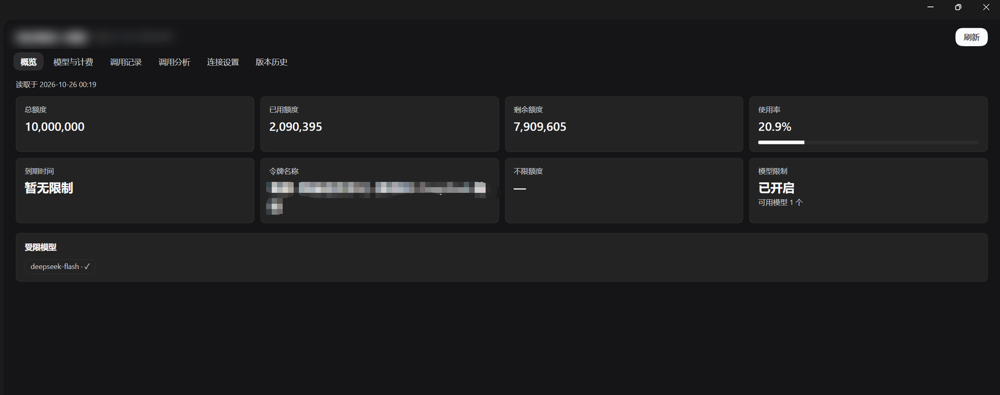
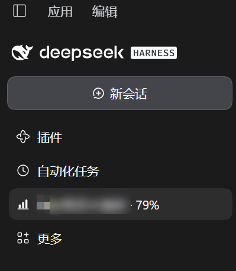
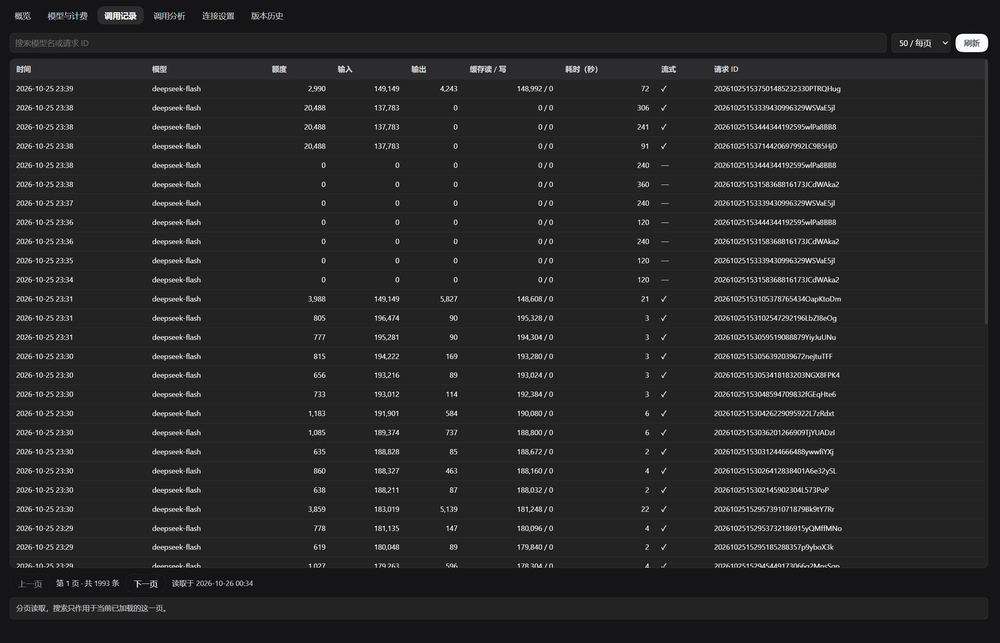

# dsh-ai-quota

[English](README.en.md) | **中文**

AI 额度面板 —— 一个 **DeepSeek Harness（DSH）** 的 Cordis 插件。

把公司 AI 额度网关（基于 [New API](https://github.com/Calcium-Ion/new-api)）做成 Harness Web UI 里的常驻面板：侧边栏那一行直接显示剩余额度百分比，点图标即刷新；点进去可以看额度概览、模型限制、分页调用记录、模型计费，以及按时间范围做的调用分析与钻取。

- 界面在浏览器里（React + 主题变量，**不依赖任何 Harness 客户端包**），数据由 Harness 的 Host 进程直连内网网关。
- skey 只存进本机凭据库（Harness `credentials`），**不写浏览器存储、不回传页面**——页面只知道「已配置 / 未配置」。
- 只读：全程只发 GET，不修改网关任何数据。
- 侧边栏与面板标题的**显示名称可自定义**（默认「AI 额度」），见[显示名称](#显示名称)。
- 与同目录源码的桌面版 `ai-quota-tauri`（Tauri 2 + Rust + React，v0.3.0）功能对齐，但不用再单独开一个客户端。



侧边栏那一行把剩余额度直接挂在名字后面 —— 点图标即刷新，点文字进面板（截图里的名字是配置出来的，已做脱敏）：



调用记录：服务端分页（20 / 50 / 100 每页）、行内搜索模型名与请求 ID、点行看全部字段：



## 显示名称

侧边栏那一行和面板标题都用同一个可配置名称，默认是「AI 额度」：

1. 打开面板 → **连接设置** → 「显示名称」。
2. 输入你的名字（最多 40 字符，例如 `AI 额度`、`团队额度`、`研发配额`），**移出输入框或按回车**立即生效——侧边栏那一行和面板标题同时改。
3. 清空即恢复默认「AI 额度」。

实现上它是**纯浏览器偏好**：

- 存在 `localStorage` 的 `dsh-ai-quota/display-name`，不进凭据库、不上传、不影响别人；
- 换浏览器或清缓存后回到默认值；
- 只改名字，不改路由、不改数据，百分比照旧跟在名字后面（`我的额度 · 79%`）。

## 侧边栏额度百分比

侧边栏那一行显示成 `<显示名称> · 79%`：

| 行为 | 说明 |
| --- | --- |
| 数字含义 | `剩余额度 ÷ 总额度`，四舍五入到整数；无限额度显示 `∞` |
| 自动更新 | 每 15 分钟一次（页面打开期间；关掉标签页即停） |
| 手动更新 | **点那一行的柱状图图标**（不会打开面板，图标转圈 → 绿/红）；点文字才是进面板。面板右上角「刷新」等价 |
| 回到标签页 | 自动更新一次（30 秒节流，避免来回切窗口把网关打满） |
| 查不到就不显示 | 没 skey、网关不通、业务失败、返回里没额度字段 —— 只留名字，绝不留一个过期数字 |
| 清凭据 | 保存/清除 skey 时立刻抹掉数字 |

## 功能

| 标签页 | 内容 |
| --- | --- |
| 连接设置 | 服务器地址、skey 保存 / 从环境变量 `AI_QUOTA_SKEY` 导入 / 清除凭据 |
| 概览 | 总额度、已用、剩余、占比、到期时间（`expires_at <= 0` 显示「暂无限制」）、令牌名、模型限制开关与逐模型上限 |
| 模型与计费 | `/v1/models` 的模型清单与端点类型；`/api/pricing` 的价格表与分组倍率 |
| 调用记录 | 服务端分页（20 / 50 / 100），行内搜索模型名与 request_id，点行看完整字段 |
| 调用分析 | 时间范围 + 时区（UTC / UTC+8）+ 天/小时粒度；Host 分页采集后本地聚合出额度趋势、token 趋势、模型排行、24 小时分布；点柱子钻取明细（50 条/页） |
| 版本历史 | 每个版本改了什么 |

调用分析是「采集 + 本地聚合」：Host 从第 1 页顺着翻，直到拿到不满 50 条的页为止（网关唯一的结束信号），按 `id` 去重并统计范围外/重复/冲突条数，再按粒度和时区聚合。保护上限 20000 页 / 200000 条 / 30 分钟，触顶时状态行会说明结果可能不完整。

## 安装

前提：本机有 DeepSeek Harness（Web UI 可用）。

**一句话装**（从 npm 取最新版，不用 clone）：

```
plugin_manager  install_bundle  target = dsh-ai-quota
```

装完刷新 Web UI，侧边栏面板区出现「AI 额度」图标（位置在「插件 / 自动化任务」之后）。

> 国内网络如果卡在 registry 上，可以指定源：`install_bundle` 传 `registry = https://registry.npmjs.org`（国内镜像 npmmirror 对新包有几分钟同步延迟）。

从源码装（要改代码时用）：

```powershell
git clone https://github.com/hustwxw/dsh-ai-quota.git
```

```
plugin_manager  install_bundle  target = <克隆目录的绝对路径>
```

开发时改动 `client.js` 后刷新页面即可生效；改动 `index.js`（Host 半）需要重启 Harness。装了依赖的 pnpm store 里 React 18 时，`npm test` 里的渲染测试才会真正跑，否则自动 SKIP。

### 让别的 agent 自己装

这个仓库和 npm 包对 agent 都是自描述的：`package.json` 的 `dsh.bundle.patch` / `dsh.client` 说明它是 DSH bundle，`README` 给了全部步骤。把下面这段直接丢给另一台机器上的 agent：

```text
用 DSH 的 plugin_manager 执行 install_bundle，target 填 dsh-ai-quota（npm 包名），
启用后刷新 Web UI，侧边栏出现「AI 额度」图标即安装成功。
然后打开面板 → 连接设置，填你自己的网关地址与 skey。
只有需要改代码时才 git clone https://github.com/hustwxw/dsh-ai-quota 并按目录安装。
```

前置条件只有两条：目标机器装了 DSH 且 Web UI 可用；能访问你自己的 New API 网关（内网 / VPN）。

npm 包主页：<https://www.npmjs.com/package/dsh-ai-quota>

## 配置

1. 侧边栏 → AI 额度 → 连接设置。
2. 服务器地址：只接受 `http(s)://主机:端口`，带路径会被拒绝；留空用默认值。
3. 填 skey 保存；或先把 skey 放进环境变量 `AI_QUOTA_SKEY`，再点「从环境变量导入」。
4. 保存后概览会自动拉一次；某块失败只影响那一块，原因显示在对应卡片下方。

默认网关地址是占位值 `http://newapi.example.com`（写在 `index.js` 的 `DEFAULT_BASE_URL`）。首次使用时在「连接设置」里填你自己的 New API 地址即可；想让默认值就是自己的地址，改这一行常量。

## 数据与隐私

- skey 存于凭据库键 `ai-quota/default`（`kind: api-key`），服务器地址存在同一条记录的 `env.AI_QUOTA_BASE_URL`。
- 显示名称只写 `localStorage`（`dsh-ai-quota/display-name`），不进凭据库、不上传。
- 页面通过同源 `POST /x-ai-quota/...` 与 Host 通信，请求要过 Harness 的连接校验；凭据本体不出 Host。
- 调用分析的行数据只存在 Host 内存里，任务上限 4 个，Host 重启即清空。
- 网关响应按字段白名单裁剪后才回给页面（额度 8 个字段、模型 2 个、价格 7 个、日志 12 个），未知字段不会进 UI。

## 接口契约

- 只调用四个只读接口：`GET /api/usage/token/`、`GET /v1/models`、`GET /api/pricing`（不带鉴权）、`GET /api/log/token`。
- 20 秒超时、不走代理、不跟随重定向、响应上限 8 MiB；**HTTP 200 也可能是业务失败**，所以逐个接口校验 `code` / `success`。
- 分页 1-based，`page_size` 只能取 20 / 50 / 100；分析窗口用 `[start, end)`，`end` 传「最后一秒 + 1」。
- 缺字段就是缺，不补 0：界面上的「未返回」表示接口没给这个字段。

## 已知限制

- 调用分析必须把范围内的日志全量翻一遍，数据量大时耗时长（每页间隔 300 ms，避免压垮网关）。
- 24 小时分布、模型排行和趋势图都基于同一次采集；切换模型筛选会重新聚合，但不重新采集。
- 百分比只反映令牌级剩余额度，不按模型拆分。

## 开发与测试

```powershell
node tests/host-test.mjs      # Host 半：假网关跑通 4 个接口、白名单、分页、采集与聚合
node tests/locale-check.cjs   # 注册 2 个槽位、中英字典 148 键对齐、没有死键
node tests/render-test.mjs    # 用真 React 18 渲染 37 个用例（需要 React 18，见下）
```

`tests/host-test.mjs` 会起一个监听随机端口的假网关（4 个接口 + 120 条日志），把 `index.js` 装进假 ctx 后从头到尾跑一遍，**不碰真实网关也不需要 skey**。

渲染测试需要 React 18，按以下任一方式提供（都没有就 SKIP）：

```powershell
pnpm add -D react@18 react-dom@18          # 装进本仓库
$env:REACT_ROOT = 'C:\some\node_modules'   # 或指向已装 React 18 的 node_modules
$env:DSH_NODE_MODULES = '<DSH 目录>\node_modules'   # 或指向 DSH 的 pnpm store
```

## 结构

```
index.js           Host 半：凭据读写、网关转发、分析采集与聚合、HTTP 路由（仅 node: 内置模块）
client.js          浏览器半：面板 UI + 侧边栏图标/百分比/显示名称（React + 主题变量，无第三方依赖）
cordis.patch.yml   把插件插入 Harness 的 bundle patch
locale/zh.json     面板标题与描述（中文）
locale/en.json     面板标题与描述（英文）
icon.svg           侧边栏图标
docs/              README 用的截图
tests/             三个自测脚本（假网关集成测试、语言包自检、React 渲染测试）
```

包名 `dsh-ai-quota` 直接对应 npm 上的同名包，`install_bundle` 传包名即可安装；从源码装则是把 target 换成克隆目录。

## 许可

[MIT](LICENSE) © 2026 hustwxw
